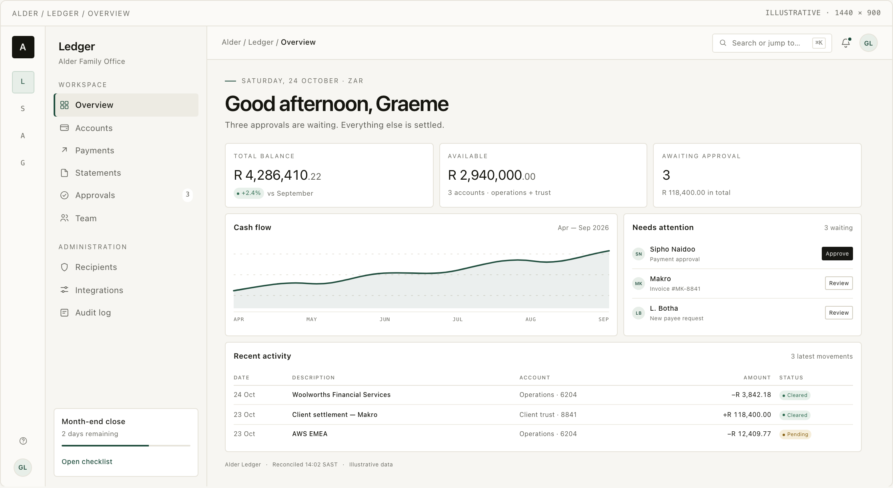

# Quiet Design System

**Project `quiet-design-system` · design language Quiet · v1.0.0**

[](LICENSE)

**The Alder family design system.** A single, technology-neutral look-and-feel and UX architecture for every application in the family — chosen, documented, versioned, licensed and machine-checkable.

Source: [github.com/graeme-lockley/quiet-design-system](https://github.com/graeme-lockley/quiet-design-system) · MIT licensed.



---

## Point an agent here

If you are handing a UI task to a coding or design agent, give it this repository and tell it to start with **[`AGENTS.md`](AGENTS.md)**. That file is the standing contract: reading order, non-negotiables, delivery workflow and definition of done.

| You want to… | Open |
| --- | --- |
| Put an agent to work | [`AGENTS.md`](AGENTS.md) — then [`agent/brief.md`](design-system/agent/brief.md) |
| See the language | [`design-system/reference/index.html`](design-system/reference/index.html) — light/night toggle |
| Get exact values | [`design-system/tokens/tokens.json`](design-system/tokens/tokens.json) |
| Understand the taste | [`design-system/docs/design-language.md`](design-system/docs/design-language.md) |
| Review a delivery | [`design-system/agent/review-checklist.md`](design-system/agent/review-checklist.md) |
| Know what a delivery must contain | [`design-system/agent/delivery-contract.md`](design-system/agent/delivery-contract.md) |
| Understand a decision | [`design-system/decisions/`](design-system/decisions/) |

**Shortest handoff to a chat-based agent:** paste [`agent/brief.md`](design-system/agent/brief.md), attach [`tokens.json`](design-system/tokens/tokens.json), and point it at the reference. The brief includes a standalone token card for agents that cannot read files.

### Prompt to start a delivery

> Work in the delivery repository. The design source is this project, **Quiet 1.0.0**.
> Read `AGENTS.md` first, then `design-system/tokens/tokens.json`.
> Follow `design-system/agent/delivery-contract.md` and complete
> `design-system/agent/review-checklist.md`. Do not invent tokens or components;
> propose gaps instead. Design light and night, and every state.

---

## What this is

A **design contract**, not a UI library. It contains:

- **A language** — warm paper, near-black ink, one deep green, hairlines, one sans-serif, type-led hierarchy and a designed night mode.
- **Semantic tokens** — one canonical JSON source, with a generated CSS adapter and a human-readable reference.
- **A UX architecture** — the family shell, navigation model, page grammar, cross-app continuity, states and content rules.
- **Component contracts** — anatomy, states and behaviour, not implementation.
- **An agent brief and delivery contract** — how to brief a screen, and what proof a delivery must return.
- **A living reference** — plain HTML/CSS purely to make the language judgeable in both modes.
- **Validation** — CI checks token completeness, contrast, generated files, versions and links.

It does **not** contain production components, a licensed typeface, a logo, or a decision about any delivery's stack. Those belong to the delivery.

**Naming note.** `Alder`, `Ledger`, `Studio`, `Atlas` and `Signal` are placeholder names from the reference. The language is **Quiet**. Rename the family in a delivery without changing the tokens, the accent policy or the grammar.

---

## The language in one paragraph

Quiet is a daylight language for consequential software. It removes what competes with the work and uses what remains — type, space, a hairline, one accent — with precision. Warm paper (`#F7F6F2`), near-black ink (`#15150F`), one deep evergreen (`#1F4D3D`). One sans-serif. Cards are 1px lines, 8px radius, 20px padding, no shadow. The only filled control is the primary action: ink by day, paper at night. Money is tabular and right-aligned. Motion settles in 120–280 ms. Night is graphite and verdigris — a real mode, not an inversion.

The accent is the one colour that means **“you can act here” or “this is live”**: links, focus, active navigation, selection and the primary data series. It is never the primary button, a status or an app colour. App identity is the monogram.

---

## Repository map

```
.
├── AGENTS.md                      ← the agent contract; read first
├── CLAUDE.md                      ← Claude Code pointer
├── llms.txt                       ← index for LLM crawlers / agents
├── README.md                      ← this file
├── CONTRIBUTING.md                ← how the system changes
├── CHANGELOG.md
├── LICENSE
├── VERSION
├── package.json                   ← tooling only; no runtime dependencies
├── design-system/
│   ├── README.md                  ← the system map and reading order
│   ├── docs/
│   │   ├── design-language.md
│   │   ├── ux-architecture.md
│   │   ├── components.md
│   │   ├── dark-mode.md
│   │   └── iconography.md
│   ├── assets/icons.svg           ← reference icon sprite
│   ├── tokens/
│   │   ├── tokens.json            ← canonical source of truth
│   │   ├── quiet.tokens.css       ← generated CSS adapter
│   │   ├── token-reference.md     ← generated human reference
│   │   └── README.md
│   ├── agent/
│   │   ├── README.md              ← how to brief an agent
│   │   ├── brief.md               ← paste-ready screen brief
│   │   ├── delivery-contract.md   ← what a delivery must contain
│   │   ├── review-checklist.md    ← definition of done
│   │   └── examples/
│   │       ├── ledger-overview.md
│   │       └── conversation.md
│   ├── decisions/                 ← README + six ADRs
│   └── reference/
│       ├── index.html             ← the living reference
│       ├── reference.css
│       ├── reference.js
│       └── screens/
├── scripts/
│   ├── build-tokens.mjs
│   └── validate.mjs
├── .github/
│   ├── workflows/validate.yml
│   ├── copilot-instructions.md
│   ├── ISSUE_TEMPLATE/system-gap.md
│   └── PULL_REQUEST_TEMPLATE.md
└── archive/
    └── exploration/               ← historical four-direction explorer
```

---

## Using it on a delivery

1. Give the delivery repository `AGENTS.md`, [`tokens.json`](design-system/tokens/tokens.json) and [`brief.md`](design-system/agent/brief.md) — or simply link this repository.
2. Fill in the brief's context: app, screen, person, primary job, primary action, what must not be lost.
3. Build in the delivery's own stack. Use semantic roles; do not copy the reference implementation or fork tokens.
4. Return a `DESIGN.md` per the [delivery contract](design-system/agent/delivery-contract.md), with light/night/mobile screens, all states, the token map, and the completed [review checklist](design-system/agent/review-checklist.md).
5. Log every deviation and every missing token/pattern back to this repository.

The design system is versioned. A delivery should pin the version and commit it was built from; `Quiet 1.0.0` is the current release.

---

## Local checks

No install required; Node 20+ standard library only.

```bash
npm run check        # tokens, contrast, generated files, versions, links
npm run build:tokens # regenerate quiet.tokens.css + token-reference.md
```

Open [`design-system/reference/index.html`](design-system/reference/index.html) directly in a browser — no server required. Use the Light / Dark / System switch at the top right.

---

## A note on the archive

The four-direction explorer — Quiet, Nocturne, Folio, Calibre — is preserved in [`archive/exploration/`](archive/exploration/) with its decision record. It exists to explain *why* Quiet was chosen. It is not current guidance, and agents must not import it.

---

## License

MIT © 2026 Graeme Lockley. See [LICENSE](LICENSE). Contributions are accepted under the same license.

**Version 1.0.0 · captured 24 October 2026 · Quiet Design System**
