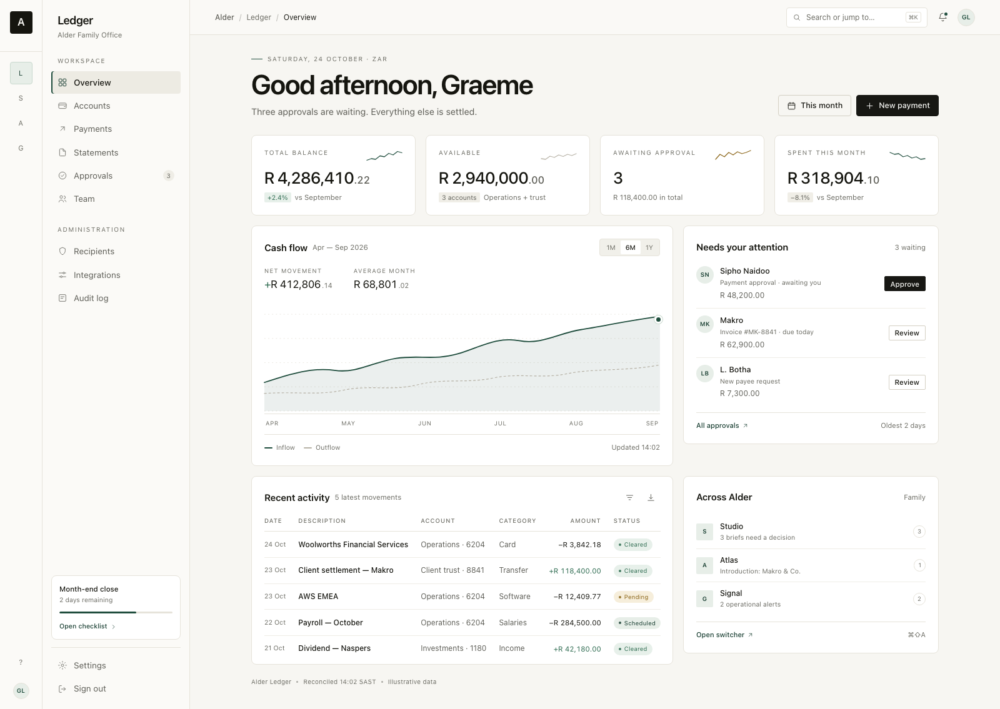
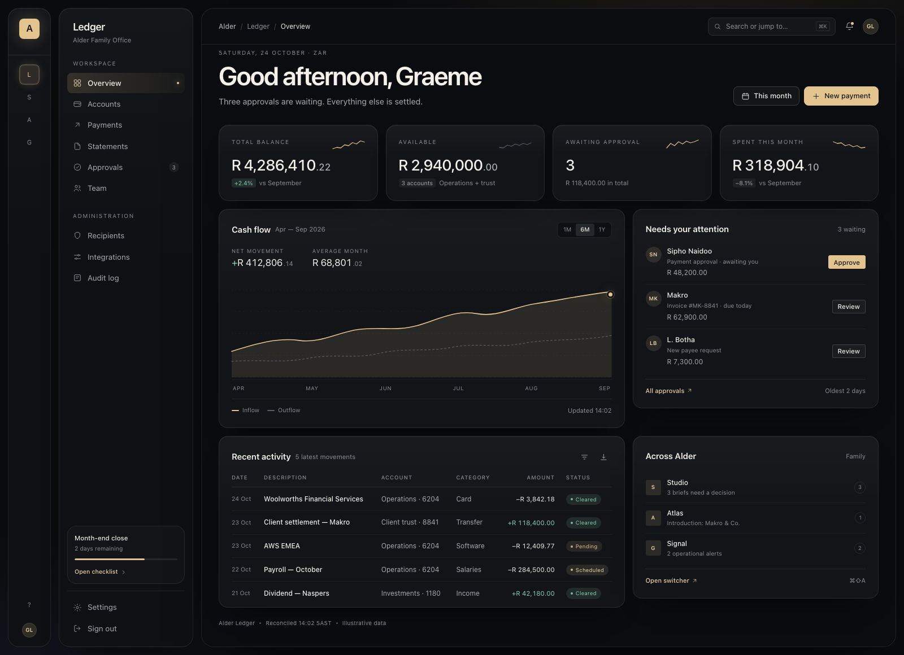
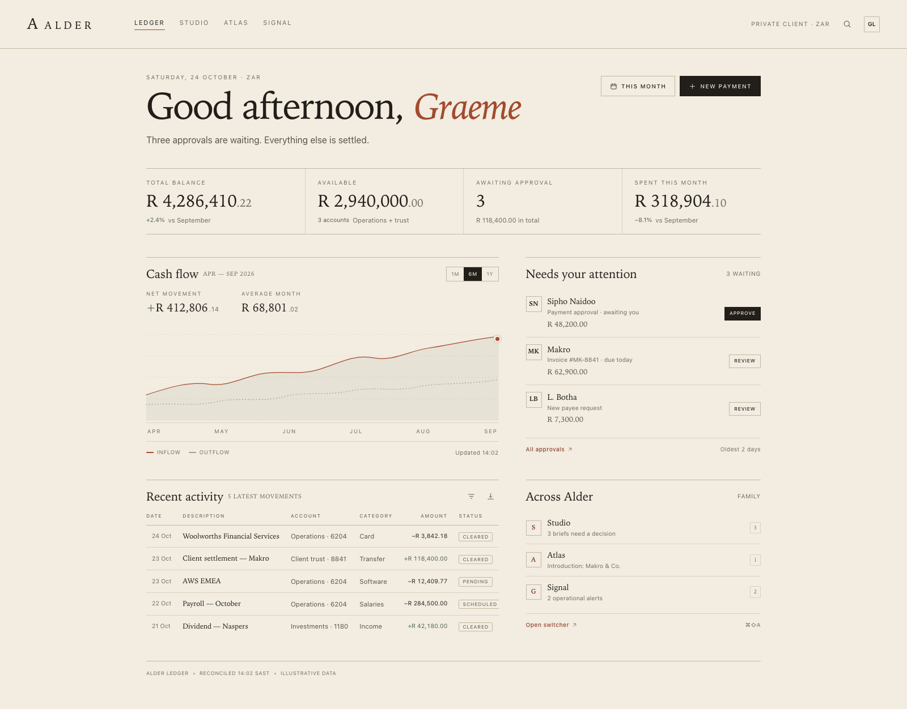
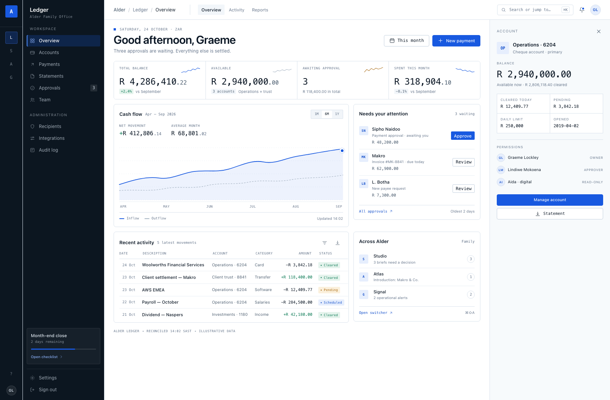

# Four directions for the family look-and-feel

**Status:** decided — **Quiet** chosen 24 October 2026. Captured as a portable system in [`design-system/`](../../design-system/README.md). This page remains the decision record.
**Inputs reviewed:** the app running at `http://localhost:8080` (monochrome, hairline-bordered, SF-set, content-first), your stated taste — Investec cleanliness with Apple-ish sophistication rather than clutter — and the requirement for a family of applications that work together.

> The four directions below are complete visual languages, not skins. Type, colour, density, chrome, navigation and motion change together. All four share the same information architecture so you are comparing feel, not flow.

---

## The short list

| | Direction | In one line | Character |
| --- | --- | --- | --- |
| **01** | **Quiet** | Private-bank restraint, with Apple's typographic calm. | Warm paper, ink, one deep green, hairline structure, no elevation. |
| **02** | **Nocturne** | The same confidence after hours. Light as an edge, not a shadow. | Graphite, champagne, floating panels, lit edges. Dark-first. |
| **03** | **Folio** | A private library, not a dashboard. Type does the ornament. | Bone paper, high-contrast serif, terracotta, rules instead of cards. |
| **04** | **Calibre** | Cool light, graphite navigation, monospaced data. | Dense, technical, dark spine, inspector panel, electric blue. |

Open [`compare.html`](compare.html) for all four side by side, or [`index.html`](index.html) to move through them at full size.

---

## 01 — Quiet · *paper & ink*

**The idea.** Warm paper, near-black ink and a single deep green. Structure comes from hairline rules, generous margins and exact alignment rather than shadows or colour. Apple's contribution is typographic calm and proportion; Investec's is the confidence to leave things out.

**What changes structurally.** Two-level navigation (app rail + sidebar), a centred content column, four flat KPI cards, hairline table, almost no chrome. Accent appears only where something is live, actionable or in motion.

**Best for.** Client-facing accounts, statements, approvals, records — anywhere trust matters more than novelty.

**Watch out.** It depends on space and type discipline. Compress the margins or add a second accent and the confidence disappears; it becomes an ordinary minimal dashboard.

**Why it is recommended.** It is the closest to the taste already on your screen, the easiest to keep coherent across several products, and the least likely to date. It also extends naturally into a night mode — which is exactly what Nocturne is.

---

## 02 — Nocturne · *graphite & champagne*

**The idea.** Near-black graphite, warm champagne and floating panels whose depth comes from a single lit edge. Dark-first, but not "dark mode as an afterthought": the composition is built for evening use, long sessions and a sense of privacy.

**What changes structurally.** The rail and sidebar become floating cards; the content sits in its own rounded surface; background aurora and edge highlights replace borders as the depth cue; the accent is warm and rare.

**Best for.** Focus workspaces, monitoring, reading, and the evening half of any client-facing product.

**Watch out.** Dense tables are harder to read. Keep fewer, better-lit elements per screen; do not use it for the operational screens that Calibre is built for.

**Relationship to Quiet.** Designed as Quiet's night side rather than a rival brand. Same bones, different light.

---

## 03 — Folio · *warm editorial*

**The idea.** Bone paper, ink, terracotta and a high-contrast serif at display sizes. Navigation moves to a masthead, rules replace cards, and numbers are set like a printed statement. This is the direction that gives the family an identity you could recognise without a logo.

**What changes structurally.** No sidebar or app rail on the content surface; a masthead carries the family and app names. Dashed cards give way to top rules. KPI figures sit in a ruled ledger strip. UI labels become small caps.

**Best for.** Client portals, research, correspondence and records — a family with a strong point of view.

**Watch out.** Serif display needs curation and air. It resists dense operational screens, and dark mode is not a natural fit; pair it with Quiet or Nocturne for dark surfaces.

---

## 04 — Calibre · *precision instrument*

**The idea.** A white instrument panel with a dark navigation spine. Dense rows, tabular monospace figures, a persistent inspector and an electric-blue accent used only where action is required. It is designed to be read quickly by someone who uses it every day.

**What changes structurally.** Dark rail + dark sidebar, top-level tabs, a split view with a permanent account inspector, a divided KPI strip, and a compact table with monospaced numerals.

**Best for.** Operations, reconciliations, admin consoles — anything with tables and consequential actions.

**Watch out.** It can read cold or intimidating to clients. Reserve it for back-office or expert surfaces, or use it as the operational wing of a family whose client face is Quiet.

---

## Recommendation (as proposed)

**Proposed:** Quiet as the base language, with Nocturne's material as the night expression.

**Decision:** Quiet, with a designed night mode in graphite and verdigris. The captured system is in [`design-system/reference/index.html`](../../design-system/reference/index.html).

**Why Quiet won.**

- It is the most direct descendant of the taste already on screen, and the most scalable across a family: one token set, many apps, no visual arms race.
- It is the easiest language to keep coherent when a design agent improvises, because almost every decision reduces to type, space or a hairline.
- Its night mode could be designed as the same system after dark — graphite surfaces, the same green lightened to verdigris — rather than a second brand.
- **Folio** remains the more ownable identity and the right answer for a smaller, curated brand surface. It was not chosen for the product language because it resists dense operational screens and dark mode.
- **Calibre** remains the right answer for the operational end of a family whose client face is Quiet. It was not chosen as the shared language because it reads cold to clients.

A hybrid was offered and not taken. The system can still borrow a masthead treatment, an editorial accent or a compact density later without re-cutting the language — as long as it does not introduce a second accent.

---

## The shared UX spine (common to all four)

The choice changes the surface, not the skeleton. These decisions were common to all four directions and are captured in the system:

- **One family shell.** An app switcher rail, a sidebar for the current app, a contextual top bar, and a content surface. The rail is identity; the sidebar is place; the top bar is context and global action.
- **Two levels of chrome, then content.** App → section → object. Object detail opens in a side panel when the task is a glance or a comparison, and in its own surface when the task becomes the work. Never a third nested sidebar.
- **Every app speaks the same grammar.** An Overview with a small number of consequential figures, a "needs attention" queue, recent activity, and one family surface that shows what is waiting in the other apps. The nouns change; the grammar does not.
- **Cross-app continuity.** One account and organisation context, one command palette and search, one notification model, one date/currency/number convention.
- **Identity lives in one place.** One wordmark, one monogram, one avatar treatment. App identity is a letter, not a separate logo and colour scheme.
- **State coverage is designed, not improvised.** Empty, loading, partial, error, offline, success, and destructive confirmation each have a contract.
- **Accessibility is a constraint, not a review.** WCAG AA contrast, visible focus, a complete keyboard path, and reduced motion are part of every component contract.
- **Motion is a settle, not an entrance.** 120–280 ms, one easing family, no decorative looping.

---

## What was captured

The choice became a portable design system — deliberately **technology-agnostic**. Nothing in it assumes React, Swift, Flutter, Tailwind, CSS or any other implementation.

1. **Design language** — the idea, principles, accent policy and voice: [design-language.md](../../design-system/docs/design-language.md).
2. **Semantic tokens** — colour roles, type, space, layout, radius, elevation, motion, data viz, contrast: [tokens.json](../../design-system/tokens/tokens.json).
3. **UX architecture** — family shell, navigation, page grammar, cross-app continuity, states, content rules, responsive, accessibility: [ux-architecture.md](../../design-system/docs/ux-architecture.md).
4. **Component contracts** — anatomy, states and behaviour for the core set, including the conversation surface: [components.md](../../design-system/docs/components.md).
5. **Agent brief** — a paste-ready directive with hard don'ts, a definition of done and a standalone token card: [agent brief](../../design-system/agent/brief.md).
6. **Reference specimen** — a rendered proof in light and night: [reference](../../design-system/reference/index.html).
7. **Night mode** — the rules, token mapping and verification checklist: [dark-mode.md](../../design-system/docs/dark-mode.md).

The explorer remains the record of the choice; the design system does not depend on it.

---

## Closed decisions

| Question | Answer |
| --- | --- |
| Direction | **Quiet** — warm paper, ink, one deep green, hairlines, type-led hierarchy. |
| Accent | **One family accent.** Evergreen by day, verdigris at night. A per-app tint is documented as an optional, strictly scoped extension, off by default. Identity lives in the monogram. |
| Dark mode | **Yes.** Light + night, system default with a per-device override. Night is a designed mode, not an inversion. |
| Brand constraints | **None supplied.** The system uses a neutral monogram/wordmark slot, ready for a real mark later. |
| Technology | **None assumed.** Values are data; components are contracts; the reference is a rendering. |

No open question blocks a build. The next useful step is one real screen through [agent brief](../../design-system/agent/brief.md).
