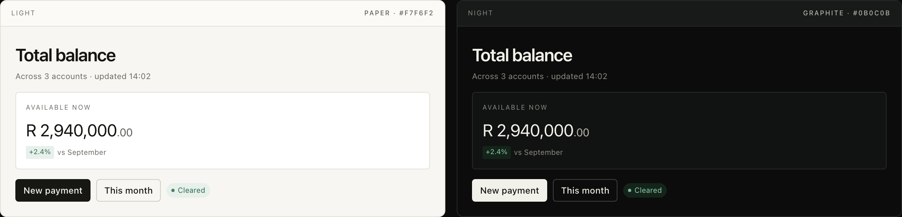

# Quiet Design System

**Project `quiet-design-system` · Alder family design language · v1.1.0 · light + night**



This folder is the **contract** behind every Alder delivery: one language, one token source, one UX architecture, one component vocabulary, one brief, one checklist.

It assumes no implementation technology. Values are semantic roles; components are behaviour; the reference is a rendering, not a library.

---

## Start here

| If you are… | Start with |
| --- | --- |
| an agent building a screen | [`../AGENTS.md`](../AGENTS.md), then [`agent/brief.md`](agent/brief.md) |
| a designer reviewing the language | [`docs/design-language.md`](docs/design-language.md) and [`reference/index.html`](reference/index.html) |
| an engineer mapping values | [`tokens/tokens.json`](tokens/tokens.json) and [`tokens/quiet.tokens.css`](tokens/quiet.tokens.css) |
| a reviewer | [`agent/review-checklist.md`](agent/review-checklist.md) |
| someone asking "why?" | [`decisions/`](decisions/) |

---

## Reading order

1. [`docs/design-language.md`](docs/design-language.md) — the idea, six principles, accent policy and voice.
2. [`tokens/tokens.json`](tokens/tokens.json) — the exact roles and values.
3. [`docs/ux-architecture.md`](docs/ux-architecture.md) — the family shell, navigation and page grammar.
4. [`docs/components.md`](docs/components.md) — component contracts.
5. [`docs/dark-mode.md`](docs/dark-mode.md) — the night rules.
6. [`docs/iconography.md`](docs/iconography.md) — the icon rules and reference set.
7. [`agent/delivery-contract.md`](agent/delivery-contract.md) — what a delivery must contain.
8. [`agent/review-checklist.md`](agent/review-checklist.md) — the definition of done.
9. [`reference/index.html`](reference/index.html) — the rendered proof, both modes.

The agent brief is [`agent/brief.md`](agent/brief.md); it is the paste-ready companion to this reading order.

---

## Map

| Path | Contents |
| --- | --- |
| `docs/design-language.md` | The idea, principles, accent policy, voice, do/don't, accessibility commitments. |
| `docs/ux-architecture.md` | Family shell, navigation, page grammar, cross-app continuity, states, content, responsive, accessibility. |
| `docs/components.md` | Anatomy, states and behaviour for the core set, including conversation and agent activity. |
| `docs/dark-mode.md` | Night principles, token mapping, component behaviour, pitfalls, verification. |
| `docs/iconography.md` | The 24px / 1.5px line icon rules and the reference set. |
| `assets/icons.svg` | Reference icon sprite (26 symbols). A shape reference, not a mandatory library. |
| `tokens/tokens.json` | **Canonical source of truth** — semantic colour roles, type, space, layout, density, radius, elevation, motion, data viz, contrast. |
| `tokens/quiet.tokens.css` | Generated web adapter (CSS custom properties). Do not edit. |
| `tokens/token-reference.md` | Generated human-readable tables. Do not edit. |
| `tokens/README.md` | Token usage and change rules. |
| `agent/brief.md` | Paste-ready screen brief with non-negotiables, composition recipes, don'ts and a token card. |
| `agent/delivery-contract.md` | Required artifacts, `DESIGN.md` template and file layout for every delivery. |
| `agent/review-checklist.md` | The complete definition of done. |
| `agent/examples/` | Worked examples: a Ledger overview and a conversation surface. |
| `decisions/` | Accepted ADRs: language, accent, night mode, typeface, token source, repository-as-contract, layout modes. |
| `reference/index.html` | Living reference with Light / Dark / System switching. |
| `reference/screens/` | Captures of the composed screen and the night system. |

---

## The decisions in seven lines

1. **Quiet is the language** — warm paper, ink, one evergreen, hairlines, one sans, type-led hierarchy.
2. **One accent for the family** — evergreen / verdigris, for interaction and live data only. Identity is the monogram.
3. **Night is designed** — graphite, verdigris, paper primary action, hairlines; not an inversion.
4. **One typeface** — system UI (SF Pro reference), Inter as the cross-platform fallback; tabular numerals.
5. **Tokens are the source of truth** — JSON, with generated adapters and validation.
6. **The repository is the contract** — not a component library; every delivery cites it by version.
7. **Layout has two modes** — reading holds 1180px; canvases fill the main column. A sparse desktop sidebar can collapse to 0px.

The reasoning is in [`decisions/`](decisions/). The four-direction exploration is in [`../archive/exploration/`](../archive/exploration/); it is history, not guidance.

---

## Source of truth

1. [`tokens/tokens.json`](tokens/tokens.json) wins over every document.
2. The documents win over the reference.
3. The reference wins over the examples.
4. If a case is not covered, propose an addition with values, contrast and accessibility notes. Do not invent a one-off.

The reference is plain HTML/CSS **only to make the language judgeable**. It is not a component library and does not imply a delivery stack.

---

## Using the system on a delivery

1. Pin the version and commit.
2. Fill in the brief's context and the delivery contract's `DESIGN.md`.
3. Use semantic roles from the tokens. Do not fork or copy raw values.
4. Deliver light, night and mobile screens, all states, token map, accessibility evidence and the completed checklist.
5. Record deviations and system gaps. Propose gaps back to this repo.

See [`agent/delivery-contract.md`](agent/delivery-contract.md) for the exact artifact list.

---

## Validation

```bash
npm run check
```

Runs from the repository root. It checks token completeness, contrast, version consistency, generated-file freshness and local links. No install or dependencies required.

---

*Version 1.1.0 · 24 October 2026 · MIT licensed. Archive: [`../archive/exploration/`](../archive/exploration/).*
