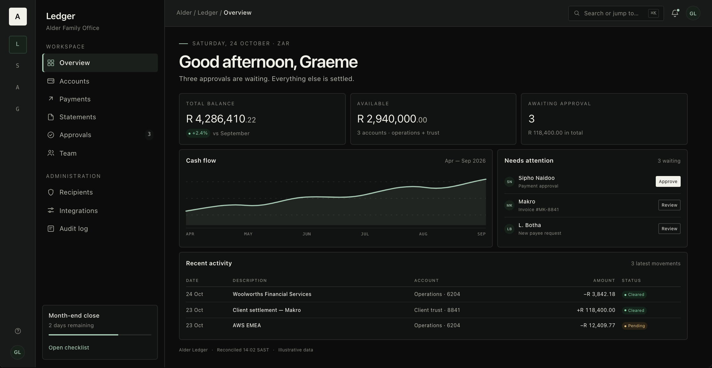

# Dark mode

**Quiet after dark. Version 1.1.0.**

Dark mode is not an inversion. It is the same room at night: the same proportions, the same hierarchy, the same single green accent — lit differently so the work stays comfortable for long sessions.

---

## 1. Principles

1. **Never pure black, never pure white.** Large surfaces are near-black graphite (`#0B0C0B`); text is warm paper (`#F2F1E9`). Pure pairs produce halation and make text vibrate.
2. **Depth from a lit edge, not a shadow.** Dark surfaces are separated by 1px hairlines and a subtle top-edge highlight. Shadows are reserved for genuinely floating surfaces (dialogs, menus, toasts).
3. **The accent gets lighter, not louder.** Evergreen is unreadable on graphite, so the same green hue moves to verdigris. It is still the only accent, and still rationed.
4. **Primary action inverts.** The ink-filled button becomes a paper-filled button with ink text. It remains the only filled control on the screen.
5. **Colour is still meaning.** Positive, negative and warning keep their semantic roles. Do not "brighten everything for dark mode"; a dashboard where every number glows is a slot machine.
6. **No glow, no gradient mesh, no neon.** Quiet after dark is a library, not a nightclub.

---

## 2. Switching

- Default to the operating system's appearance.
- Offer **Light · Dark · System** in Appearance settings, with a live preview.
- Persist the override per device, not per account.
- Apply the mode before first paint to avoid a flash of the wrong theme.
- Never ask the user to choose on first run.
- Do not reload the page to switch; tokens change in place. Charts and images must update without a reload.
- Respect `prefers-color-scheme` when the mode is "System", including a live change while the app is open.

---

## 3. Token mapping

The full values are in [`tokens.json`](../tokens/tokens.json). This is the handful that matters.

| Role | Light | Dark | Note |
| --- | --- | --- | --- |
| Canvas | `#F7F6F2` | `#0B0C0B` | Warm paper → graphite |
| Surface | `#FFFFFF` | `#111312` | Cards, panels |
| Surface raised | `#FBFAF7` | `#171A18` | Dialogs, popovers, inspector |
| Surface sunken | `#F1F0EA` | `#0D0F0E` | Tab tracks, table headers |
| Ink | `#15150F` | `#F2F1E9` | Primary text |
| Ink secondary | `#5F5F58` | `#B8B7AD` | Descriptions |
| Ink tertiary | `#6C6C64` | `#8E8D84` | Labels, timestamps |
| Line | `#E6E3DA` | `#262825` | Cards, inputs |
| Line strong | `#D4D0C4` | `#3A3D39` | Section rules, outlined buttons |
| Accent | `#1F4D3D` | `#A7C8B2` | Same green, lighter value |
| Accent wash | `#E7EEE8` | `#16211A` | Active nav, selection |
| Primary action | `#171713` | `#F2F1E9` | Inverts |
| Primary action ink | `#FAFAF7` | `#0F110F` | Inverts |
| Positive | `#2C6A4F` | `#8FD3AC` | Inflow, cleared |
| Negative | `#963A2C` | `#E8A08C` | Outflow, error |
| Warning | `#8A6416` | `#E3C286` | Pending, attention |
| Focus | `#1F4D3D` | `#A7C8B2` | 2px ring, 2px offset |

All text pairs above are verified at or above WCAG AA in both modes. The ratios are recorded in `tokens.contrast`.

---

## 4. Surfaces and elevation

**Three surface levels are enough.**

1. **Canvas** — the page. No border.
2. **Surface** — cards, tables, inputs that need separation. 1px `line`.
3. **Raised** — overlays only: dialog, drawer, command palette, popover. 1px `lineStrong` or `line`, plus `e2`/`e3`.

Rules:

- No card-on-card in dark. Use a rule or the sunken surface.
- No large areas of `#000`. The deepest surface is the canvas.
- The top edge of a raised surface may have a 1px inset highlight at 4% white to simulate a lit edge. It is not a glow.
- Never use coloured shadows.
- A dark screen should have at most one elevated surface visible at a time, apart from menus.

---

## 5. Accent in the dark

- Accent is still for links, focus, active nav and the primary data series.
- On a dark card, `#A7C8B2` reads as a soft green, not a neon. Do not increase saturation.
- `accentWash` is a deep green-black (`#16211A`), not a translucent green over everything.
- The primary button is **not** accent-filled. It is paper-filled. This keeps the accent rare.
- Hover on an accent link goes lighter (`#BBD8C5`), not darker.
- Focus ring uses the same verdigris; it must remain visible on both `surface` and `accentWash`.

---

## 6. Typography in the dark

- Keep the same type scale and weights. Do not compensate for dark mode by making everything bolder.
- Use `#F2F1E9`, never `#FFFFFF`, for body text. Pure white on near-black is too harsh for long reading.
- `inkTertiary` (`#8E8D84`) is the floor for small labels; it is 5.6:1 on the surface.
- Increase line-height slightly for long prose if the platform allows it (1.6 vs 1.55); do not change the component line-heights.
- Avoid thin weights. The system already uses 400/500/600.
- Links are accent and underlined only if the surrounding text makes them otherwise ambiguous. Never rely on colour alone.

---

## 7. Components

| Component | Dark behaviour |
| --- | --- |
| **App rail** | `surfaceRaised` or transparent over canvas; active monogram uses `accentWash`; the 2px active rule uses accent. Brand mark becomes paper with ink glyph. |
| **Sidebar** | Canvas or slightly raised; active item uses `selected` + accent icon; the inset accent rule remains. |
| **Top bar** | Translucent canvas with a 1px line; no shadow. Search trigger uses `surface`/`input` with a `line` border. |
| **Cards** | `surface`, 1px `line`, no shadow. Hover only if clickable: line becomes `lineStrong`. |
| **Inputs** | `surface` fill, `lineStrong` border, `ink` text; placeholder `inkTertiary`; focus ring accent. Disabled uses `disabledSurface` + `disabledInk`, not opacity alone. |
| **Tables** | Row separators `lineSoft`; header text `inkTertiary`; hover `hover`; selected `accentWash`. No zebra. |
| **Status pills** | Use the wash values, not transparent overlays; the text colour is the semantic colour, not white. |
| **Primary button** | Paper fill, ink label. Hover pure paper. Secondary outline uses `lineStrong`. |
| **Dialogs** | `surfaceRaised`, `e3`, scrim; the close icon is `inkSecondary`. |
| **Toasts** | `surfaceRaised`, `line`, `e2`; no coloured background. |
| **Skeletons** | `skeleton` fill; no shimmer sweep. A slow opacity pulse only. |
| **Charts** | Use the dark data-viz palette; grid `#242724`; axis `#8E8D84`; area fill ≤ 10%; end dot accent. |
| **Focus** | 2px accent ring with 2px offset; visible on canvas, surface and raised. |
| **Illustrations / empty states** | Use line illustrations in `inkTertiary`; no dark-mode-inverted colour illustrations. |

---

## 8. Imagery and brand

- Photographs: do not apply a dark filter; use the image as authored, with a subtle scrim if text sits over it.
- Logos: provide a light-on-dark variant if the mark is dark. Never invert a logo with a filter.
- App monograms: use the paper-on-ink variant in dark; the monogram is not an image and adapts with tokens.
- Brand accent: the same green, adjusted for contrast. No second brand colour for dark.

---

## 9. Common mistakes

1. **Pure black + pure white.** Harsh, halated, cheap.
2. **Inverting images and logos.** Broken brand, wrong skin tones, no control.
3. **Using opacity to create surfaces.** `rgba(255,255,255,.05)` over arbitrary backgrounds produces muddy, unpredictable results. Use defined surface tokens.
4. **Making every secondary text too bright.** If everything is white, hierarchy disappears. Keep three text levels.
5. **Neon accent.** The accent is a quiet green; do not saturate it for dark mode.
6. **Drop shadows on cards.** In dark mode they are invisible or dirty. Use hairlines.
7. **Forgetting focus and disabled states.** They are the first to disappear in dark.
8. **Hard-coded white.** Any `#fff` in a component will break dark mode. Use `ink`, `surface`, `paper` roles.

---

## 10. Verification checklist

- [ ] All text passes AA against its actual surface in both modes.
- [ ] Focus rings are visible on canvas, surface and accent wash.
- [ ] Disabled controls are legible but clearly inactive.
- [ ] Charts use the dark series palette; grid lines are visible but quiet.
- [ ] Status pills are legible and still carry their word.
- [ ] The primary button inverts and remains the only filled control.
- [ ] Images and logos are authored for dark, not filtered.
- [ ] Skeletons and empty states look intentional, not broken.
- [ ] Mode switching causes no flash and no reload.
- [ ] The "System" setting responds to a live OS change.
- [ ] Reduced motion is respected in both modes.
- [ ] Print and exported documents use the light palette regardless of the app mode.

---

*The rendered proof of both modes is [`reference/index.html`](../reference/index.html). The token values are in [`tokens.json`](../tokens/tokens.json).*
